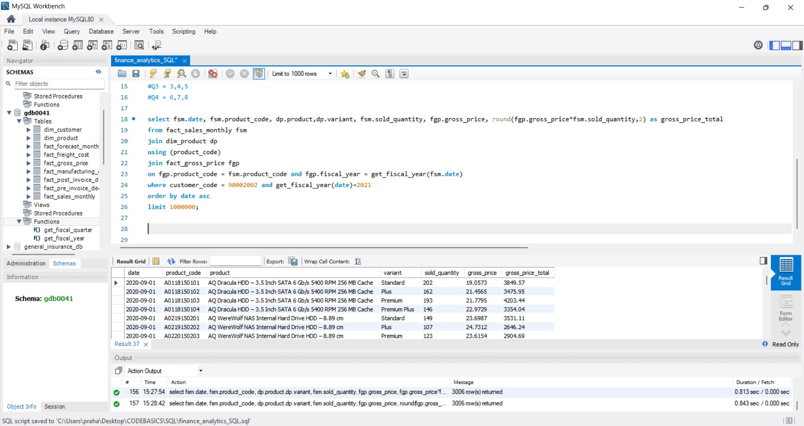
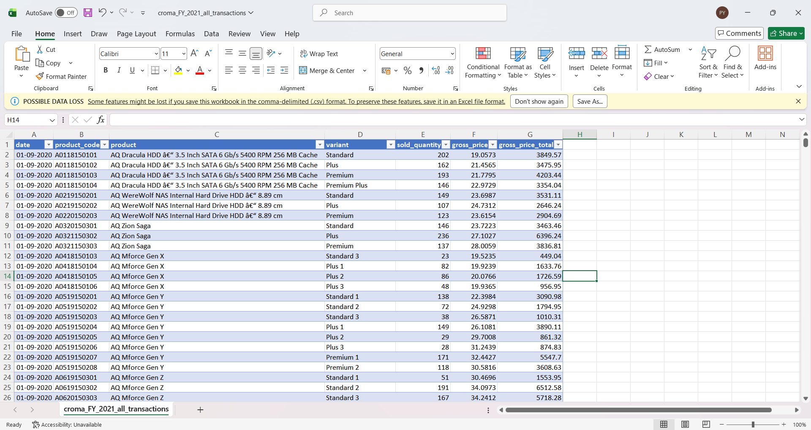

# Croma India – Product-Wise Sales Analytics (FY2021)

**Technologies:** MySQL, SQL  
**Domain:** Retail Sales Analytics  
**Learning Platform:** Codebasics  
**Industry Case Study:** AtliQ Technologies

## Project Overview

This project focuses on generating a product-wise sales report for Croma India for Financial Year 2021 using MySQL.

The project was completed as part of the SQL curriculum offered by **Codebasics**, which incorporates practical, industry-oriented learning through business scenarios and datasets.

The exercise was based on a business case presented through **AtliQ Technologies**, involving Croma India's sales data. The objective was to apply SQL concepts to retrieve product-level sales information and generate a structured report for further analysis in Microsoft Excel.

## Business Objective

Generate a product-wise sales report for Croma India (Customer Code: 90002002) for FY2021, containing the following fields:

1. Month
2. Product Name
3. Product Variant
4. Sold Quantity
5. Gross Price Per Item
6. Gross Price Total

## Tools & Technologies

- MySQL Workbench
- SQL
- CSV
- Microsoft Excel

## Technical Implementation

The project involved:

- Retrieving sales transaction records.
- Joining sales transactions with product information using product codes.
- Integrating gross pricing information using product codes and fiscal years.
- Filtering records for the specified customer and financial year.
- Calculating gross sales value using sold quantity and gross price per item.
- Sorting the resulting report chronologically.
- Creating custom SQL functions for fiscal-year and fiscal-quarter calculations.

## Fiscal Calendar

The reporting follows a September–August financial year.

| Fiscal Quarter | Months |
|---|---|
| Q1 | September – November |
| Q2 | December – February |
| Q3 | March – May |
| Q4 | June – August |

Custom MySQL functions were implemented to calculate fiscal years and fiscal quarters based on transaction dates.

## SQL Concepts Applied

- INNER JOIN
- USING clause
- WHERE clause
- ORDER BY
- Date manipulation
- Mathematical calculations
- CASE WHEN statements
- Custom SQL functions
- Relational database querying

## Dataset Overview

- 3,006 sales records
- 334 unique product codes
- 710,324 units sold across the supplied records
- Nine distinct months represented

**Data Coverage:** The supplied dataset does not contain records for November 2020, March 2021 or July 2021. The analysis reflects the available records.

## Project Screenshots

### 1. SQL Query Execution


### 2. Fiscal Year Function


### 3. Fiscal Quarter Function


### 4. Excel Sales Report

## Repository Structure

```text
croma-product-wise-sales-analytics/
│
├── README.md
│
├── finance_analytics_SQL.sql
├── get_fiscal_year_function_AtliQ.sql
├── get_fiscal_quarter_function_AtliQ.sql
│
├── croma_FY_2021_all_transactions.csv
│
└── Screenshots/
    ├── 01_Croma_SQL_Query_Execution.png
    ├── 02_Fiscal_Year_Function.png
    ├── 03_Fiscal_Quarter_Function.png
    └── 04_Croma_Excel_Sales_Report.png
```

## Key Learning Outcomes

- Translating business requirements into SQL queries.
- Working with relational databases and multiple-table joins.
- Implementing custom MySQL functions.
- Applying business-specific fiscal-year and fiscal-quarter logic.
- Integrating sales, product and pricing information.
- Preparing structured datasets for business reporting.

---

**Learning Platform:** Codebasics  
**Curriculum:** SQL  
**Industry Case Study:** AtliQ Technologies  
**Business Case:** Croma India – FY2021 Product-Wise Sales Analytics
