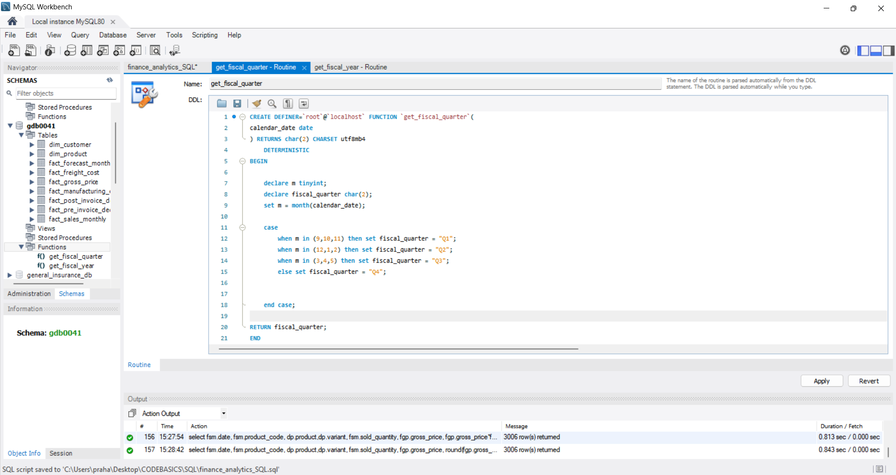
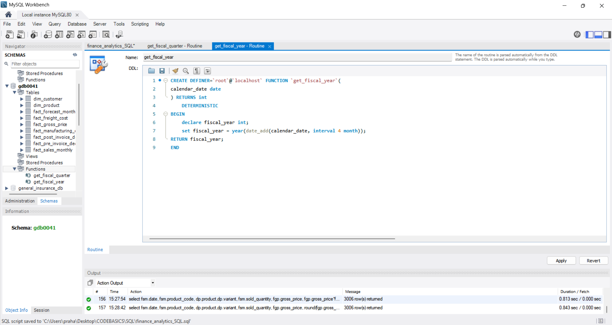
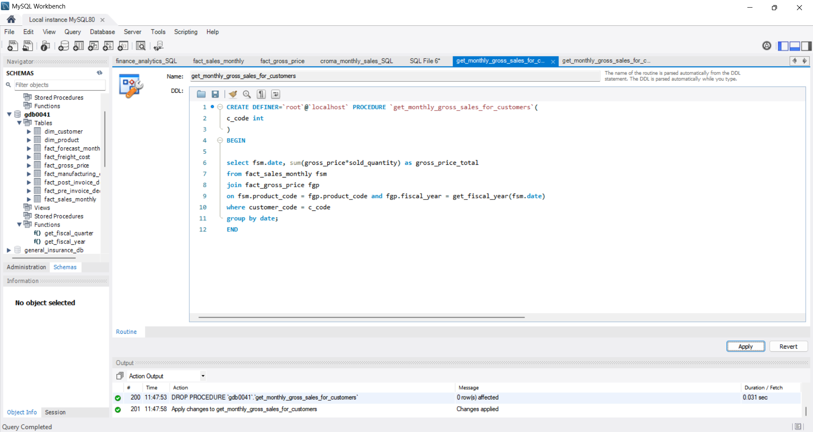
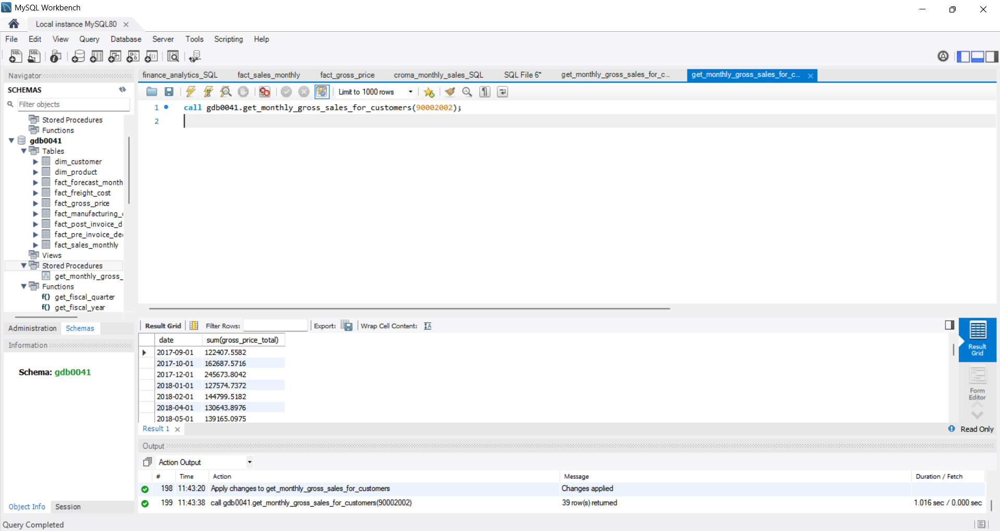
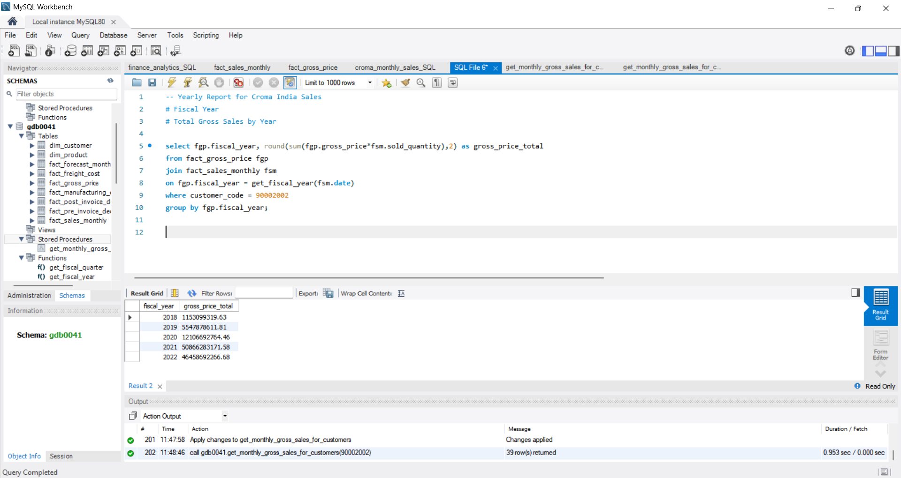
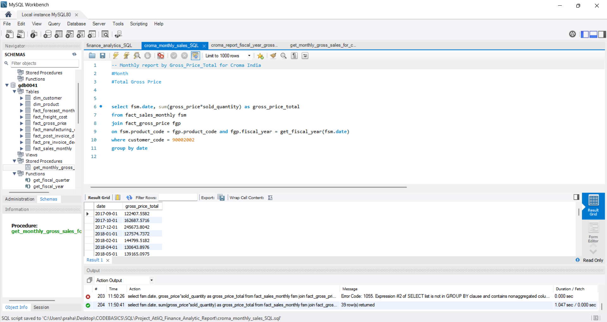

# AtliQ Finance Analytics – SQL Projects

**Technologies:** MySQL, SQL, MySQL Workbench  
**Domain:** Finance Analytics | Sales Analytics | Business Reporting  
**Learning Platform:** Codebasics  
**Industry Case Study:** AtliQ Technologies

## Project Overview

This repository showcases practical SQL projects completed as part of the SQL curriculum offered by **Codebasics**.

The curriculum incorporates industry-oriented business scenarios, datasets and analytical requirements through **AtliQ Technologies**. These projects provided an opportunity to apply SQL concepts to business reporting and data analysis problems.

The work focuses on querying relational databases, combining information from multiple tables, developing custom SQL functions and stored procedures, and generating structured sales reports.

## Projects Included

### 1. Croma India – Product-Wise Sales Analytics (FY2021)

Developed a SQL-based reporting solution to generate monthly product-wise sales information for Croma India (Customer Code: 90002002).

**Business Requirements:**
- Month
- Product Name
- Product Variant
- Sold Quantity
- Gross Price Per Item
- Gross Price Total

**Technical Implementation:**
- Joined sales, product and gross pricing tables.
- Applied customer and fiscal-year filters.
- Calculated gross sales values.
- Created custom fiscal-year and fiscal-quarter functions.

### 2. Finance Analytics – Monthly Gross Sales

Worked on SQL-based monthly gross sales reporting using customer and sales information.

**Technical Concepts:**
- Stored procedures
- SQL aggregation
- Gross sales calculations
- Customer-level reporting
- Parameterized SQL execution

### 3. Finance Analytics – Yearly Gross Sales

Developed SQL queries for yearly gross sales analysis using sales and pricing information.

**Technical Concepts:**
- Aggregate functions
- SUM()
- GROUP BY
- Fiscal-year calculations
- Relational database querying

## Tools & Technologies

| Technology | Application |
|---|---|
| MySQL | Relational database management |
| SQL | Data retrieval and analysis |
| MySQL Workbench | SQL development and execution |
| CSV | Dataset handling |
| Microsoft Excel | Sales reporting |

## SQL Concepts Demonstrated

- SELECT statements
- INNER JOIN
- USING clause
- WHERE clause
- ORDER BY
- GROUP BY
- Aggregate functions
- Mathematical calculations
- CASE WHEN statements
- Date manipulation
- Custom SQL functions
- Stored procedures
- Fiscal-year and fiscal-quarter calculations

## Fiscal Calendar

The reporting follows a September–August financial year.

| Fiscal Quarter | Months |
|---|---|
| Q1 | September – November |
| Q2 | December – February |
| Q3 | March – May |
| Q4 | June – August |

Custom MySQL functions were implemented to calculate fiscal years and fiscal quarters based on transaction dates.

## Project Screenshots

### Croma India – Product-Wise Sales Analytics

### Finance Analytics – Additional SQL Exercises

## Key Learning Outcomes

- Applying SQL to practical business reporting scenarios.
- Working with relational databases and multi-table joins.
- Writing queries for sales and financial analysis.
- Developing custom MySQL functions.
- Creating and executing stored procedures.
- Applying aggregation and grouping techniques.
- Working with business-specific fiscal calendars.
- Translating business requirements into SQL solutions.

## Learning & Project Context

**Learning Platform:** Codebasics  
**Curriculum:** SQL  
**Industry Case Study:** AtliQ Technologies  
**Project Domain:** Finance Analytics and Sales Reporting

